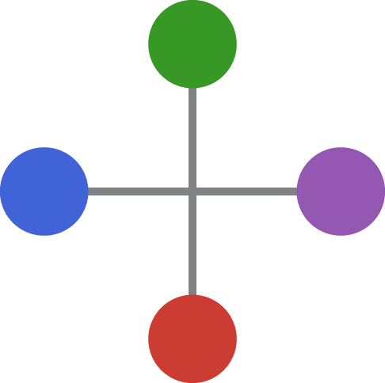

<h1>  ParallelStencil.jl </h1>

[](https://omlins.github.io/ParallelStencil.jl/stable)
[](https://omlins.github.io/ParallelStencil.jl/dev)
[](https://github.com/omlins/ParallelStencil.jl/actions/workflows/ci.yml)
[](https://gitlab.com/cscs-ci/ci-testing/webhook-ci/mirrors/7487078532071147/3127735853767612/-/pipelines)
[](https://codecov.io/gh/omlins/ParallelStencil.jl)
[](https://doi.org/10.21105/jcon.00138)

ParallelStencil empowers domain scientists to write architecture-agnostic high-level code for parallel high-performance stencil computations on GPUs and CPUs, with performance similar to CUDA C / HIP. A single code runs on Nvidia, AMD and Apple GPUs and on multi-threaded CPUs; in conjunction with [ImplicitGlobalGrid.jl](https://github.com/eth-cscs/ImplicitGlobalGrid.jl), it scales from a single CPU thread to thousands of GPUs. ParallelStencil furthermore supports hiding communication behind computation, architecture-agnostic low-level kernel programming, logical arrays of small arrays / structs, and automatic differentiation of parallel kernels with [Enzyme.jl](https://github.com/EnzymeAD/Enzyme.jl). Background, examples, miniapps and references are in the [documentation](https://omlins.github.io/ParallelStencil.jl/stable).

## Documentation
Usage, examples, miniapps and the API reference are found in the documentation:
- [**stable**](https://omlins.github.io/ParallelStencil.jl/stable): documentation of the latest release;
- [**dev**](https://omlins.github.io/ParallelStencil.jl/dev): documentation of the `main` branch.

## Installation
```julia
import Pkg; Pkg.add("ParallelStencil")
```
GPU support requires installing the corresponding package in addition (CUDA.jl, AMDGPU.jl or Metal.jl).

## Usage
```julia
using ParallelStencil
using ParallelStencil.FiniteDifferences3D
@init_parallel_stencil(Threads, Float64, 3)           # Or: CUDA, AMDGPU, Metal, Polyester (or KernelAbstractions).

@parallel function diffusion3D_step!(T2, T, Ci, lam, dt, dx, dy, dz)
    @inn(T2) = @inn(T) + dt*(lam*@inn(Ci)*(@d2_xi(T)/dx^2 + @d2_yi(T)/dy^2 + @d2_zi(T)/dz^2))
    return
end

nx, ny, nz = 64, 64, 64
T, T2, Ci  = @rand(nx, ny, nz), @zeros(nx, ny, nz), @ones(nx, ny, nz)   # Allocated on the GPU or CPU, as selected above.
@parallel diffusion3D_step!(T2, T, Ci, 1.0, 1e-4, 0.1, 0.1, 0.1)
```
A complete application is shown in the [50-lines example](https://omlins.github.io/ParallelStencil.jl/stable/examples/diffusion3D) and its [multi-xPU version](https://omlins.github.io/ParallelStencil.jl/stable/examples/diffusion3D_multixpu).

## Questions, comments and discussions
Please post on Julia Discourse in the [GPU topic](https://discourse.julialang.org/c/domain/gpu) or the [Julia at Scale topic](https://discourse.julialang.org/c/domain/parallel), or in the `#gpu` or `#hpc` channels on the [Julia Slack](https://julialang.org/slack/). Contributions are welcome; please open an issue to discuss your idea beforehand.
