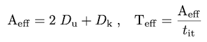

# Concise single/multi-xPU miniapps

The miniapps regroup a collection of various 2-D and 3-D codes that leverage ParallelStencil to implement architecture-agnostic high-level code for parallel high-performance stencil computations on GPUs and CPUs. The miniapps target various challenging domain science case studies where multi-physics coupling and important nonlinearities challenge existing solving strategies. In most cases, second order pseudo-transient relaxation delivers implicit solutions of the differential equations. Some miniapps feature a multi-xPU version, which combines the capabilities of ParallelStencil and [ImplicitGlobalGrid.jl](https://github.com/eth-cscs/ImplicitGlobalGrid.jl) in order to enable multi-GPU and multi-CPU executions, unleashing _Julia-at-scale_.

## [Performance metric](@id performance-metric)
Many-core processors as GPUs are throughput-oriented systems that use their massive parallelism to hide latency. On the scientific application side, most algorithms require only a few operations or flops compared to the amount of numbers or bytes accessed from main memory, and thus are significantly memory bound. The Flop/s metric is no longer the most adequate for reporting the application performance of many modern applications. This status motivated us to develop a memory throughput-based performance evaluation metric, `T_eff`, to evaluate the performance of iterative stencil-based solvers \[[1](https://www.youtube.com/watch?v=vPsfZUqI4_0)\].

The effective memory access, `A_eff` [GB], is the sum of twice the memory footprint of the unknown fields, `D_u`, (fields that depend on their own history and that need to be updated every iteration) and the known fields, `D_k`, that do not change every iteration. The effective memory access divided by the execution time per iteration, `t_it` [sec], defines the effective memory throughput, `T_eff` [GB/s]:

```@raw html

```

The upper bound of `T_eff` is `T_peak` as measured e.g. by the STREAM benchmark \[[7](https://www.researchgate.net/publication/51992086_Memory_bandwidth_and_machine_balance_in_high_performance_computers)\] for CPUs or a GPU analogue. Defining the `T_eff` metric, we assume that 1) we evaluate an iterative stencil-based solver, 2) the problem size is much larger than the cache sizes and 3) the usage of time blocking is not feasible or advantageous (which is a reasonable assumption for real-world applications). An important concept is not to include fields within the effective memory access that do not depend on their own history (e.g. fluxes); such fields can be re-computed on the fly or stored on-chip. Defining a theoretical upper bound for `T_eff` that is closer to the real upper bound is work in progress.

Using simple array broadcasting capabilities both with GPU and CPU arrays within Julia does not enable close to optimal performance; ParallelStencil.jl permits to overcome this limitation (see the [Overview](overview.md)) at similar ease of programming.

## Running the miniapps
All miniapp codes follow a similar structure and permit serial and threaded CPU as well as Nvidia GPU execution. The first line of each miniapp code permits to enable the CUDA.jl GPU backend upon setting the `USE_GPU` flag to `true`.

All the miniapps can be interactively executed within the [Julia REPL](https://docs.julialang.org/en/v1/stdlib/REPL/) (this includes the multi-xPU versions when using a single CPU or GPU). Note that for optimal performance the miniapp script of interest `<miniapp_code>` should be launched from the shell using the project's dependencies `--project`, disabling array bound checking `--check-bounds=no`, and using optimization level 3 `-O3`:
```sh
julia --project --check-bounds=no -O3 <miniapp_code>.jl
```

Refer to the documentation of your supercomputing centre for instructions to run Julia at scale, e.g. for the [Alps supercomputer at the Swiss National Supercomputing Centre (CSCS)](https://docs.cscs.ch/software/prgenv/julia/). Whether CUDA-aware or ROCm-aware MPI works on a system can be checked with the GPU examples of [MPI.jl](https://github.com/JuliaParallel/MPI.jl/tree/master/docs/examples) (e.g. `alltoall_test_cuda.jl` or `alltoall_test_rocm.jl`).

## Thermo-mechanical convection 2-D app
> app: [ThermalConvection2D.jl](https://github.com/omlins/ParallelStencil.jl/blob/main/miniapps/ThermalConvection2D.jl)

This thermal convection example in 2-D combines a viscous Stokes flow to advection-diffusion of heat including a temperature-dependent shear viscosity. The miniapp resolves thermal convection cells (e.g. Earth's mantle convection and plumes):

```@raw html

```

*The gif depicts non-dimensional temperature field as evolving into convection cells and plumes.*

## Viscous Stokes 2-D app
> app: [Stokes2D.jl](https://github.com/omlins/ParallelStencil.jl/blob/main/miniapps/Stokes2D.jl)

The viscous Stokes flow example solves the incompressible Stokes equations with linear shear rheology in 2-D. The model configuration represents a buoyant inclusion within a less buoyant matrix:

```@raw html

```

*The figure depicts - Upper panels: the dynamical pressure field, the vertical Vy velocity. Lower panels: the log10 of the vertical momentum balance residual Ry and the log10 of the error norm evolution as function of pseudo-transient iterations.*

## Viscous Stokes 3-D app
> apps: [Stokes3D.jl](https://github.com/omlins/ParallelStencil.jl/blob/main/miniapps/Stokes3D.jl), [Stokes3D_multixpu.jl](https://github.com/omlins/ParallelStencil.jl/blob/main/miniapps/stokes_multixpu/Stokes3D_multixpu.jl)

The viscous Stokes flow example solves the incompressible Stokes equations with linear shear rheology in 3-D. The model configuration represents a buoyant spherical inclusion within a less buoyant matrix:

```@raw html

```

*The figure depicts vertically sliced cross-sections of - Upper panels: the dynamical pressure field, the vertical Vz velocity. Lower panels: the log10 of the vertical momentum balance residual Rz and the log10 of the error norm evolution as function of pseudo-transient iterations. **The numerical resolution is 252x252x252 grid points in 3-D on 8 GPUs (i.e. a local domain size of 127x127x127 per GPU).***

The [Stokes3D.jl](https://github.com/omlins/ParallelStencil.jl/blob/main/miniapps/Stokes3D.jl) and [Stokes3D_multixpu.jl](https://github.com/omlins/ParallelStencil.jl/blob/main/miniapps/stokes_multixpu/Stokes3D_multixpu.jl) are single- and multi-xPU implementations, respectively. The multi-xPU implementation demonstrates ParallelStencil's capabilities to hide communication behind computation, which is performed with [ImplicitGlobalGrid.jl](https://github.com/eth-cscs/ImplicitGlobalGrid.jl) in this case. Results are obtained by running the multi-xPU miniapp on 8 Nvidia Titan Xm GPUs distributed across two physically distinct compute nodes. This multi-xPU application permits to leverage distributed memory parallelisation to enable large-scale 3-D calculations.

## Acoustic wave 2-D app
> app: [acoustic2D.jl](https://github.com/omlins/ParallelStencil.jl/blob/main/miniapps/acoustic2D.jl)

The acoustic wave example solves acoustic waves in 2-D using the split velocity-pressure formulation:

```@raw html

```

*The animation depicts the dynamical pressure field evolution as function of explicit time steps.*

## Acoustic wave 3-D app
> apps: [acoustic3D.jl](https://github.com/omlins/ParallelStencil.jl/blob/main/miniapps/acoustic3D.jl), [acoustic3D_multixpu.jl](https://github.com/omlins/ParallelStencil.jl/blob/main/miniapps/acoustic_waves_multixpu/acoustic3D_multixpu.jl)

The acoustic wave example solves acoustic waves in 3-D using the split velocity-pressure formulation:

```@raw html

```

*The animation depicts the y-slice of the dynamical pressure field evolution as function of explicit time steps. **The achieved numerical resolution is 1020x1020x1020 grid points in 3-D on 8 GPUs (i.e. a local domain size of 511x511x511 per GPU).***

The [acoustic3D.jl](https://github.com/omlins/ParallelStencil.jl/blob/main/miniapps/acoustic3D.jl) and [acoustic3D_multixpu.jl](https://github.com/omlins/ParallelStencil.jl/blob/main/miniapps/acoustic_waves_multixpu/acoustic3D_multixpu.jl) are single- and multi-xPU implementations, respectively. The multi-xPU implementation demonstrates ParallelStencil's capabilities to hide communication behind computation, which is performed with [ImplicitGlobalGrid.jl](https://github.com/eth-cscs/ImplicitGlobalGrid.jl) in this case. Results are obtained by running the multi-xPU miniapp on 8 Nvidia Titan Xm GPUs distributed across two physically distinct compute nodes. This multi-xPU application permits to leverage distributed memory parallelisation to enable large-scale 3-D calculations.

## Scalar porosity waves 2-D app
> app: [scalar\_porowaves2D.jl](https://github.com/omlins/ParallelStencil.jl/blob/main/miniapps/scalar_porowaves2D.jl)

The scalar porosity waves example solves the scalar solitary wave equations in 2-D assuming total pressure to be lithostatic, thus eliminating the need to solve for the total pressure explicitly:

```@raw html


```

*The animation depicts the normalised porosity and effective pressure fields evolution as function of explicit time steps. Top row: compaction and decompaction rheology are identical, resulting in circular solitary waves rearranging into solitons of characteristic size. Bottom row: decompaction occurs at much faster rate compared to compaction, resulting in chimney-shaped features.*

## Hydro-mechanical porosity waves 2-D app
> app: [HydroMech2D.jl](https://github.com/omlins/ParallelStencil.jl/blob/main/miniapps/HydroMech2D.jl)

The hydro-mechanical porosity wave example resolves solitary waves in 2-D owing to hydro-mechanical coupling, removing the lithostatic pressure assumption. The total and fluid pressure are explicitly computed from nonlinear Stokes and Darcy flow solvers, respectively \[[8](https://doi.org/10.1093/gji/ggz239)\]:

```@raw html

```

*The animation depicts the formation of fluid escape pipes in two-phase media, owing to decompaction weakening. Top row: evolution of the porosity distribution and effective pressure. Bottom row: Darcy flux (relative fluid to solid motion) and solid (porous matrix) deformation.*
