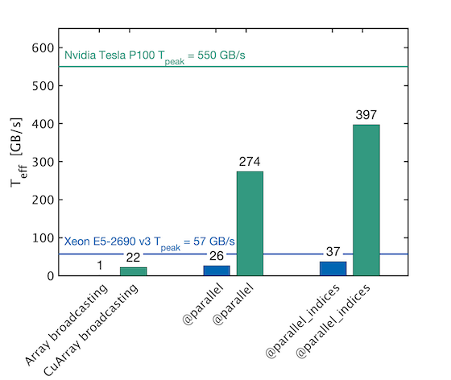
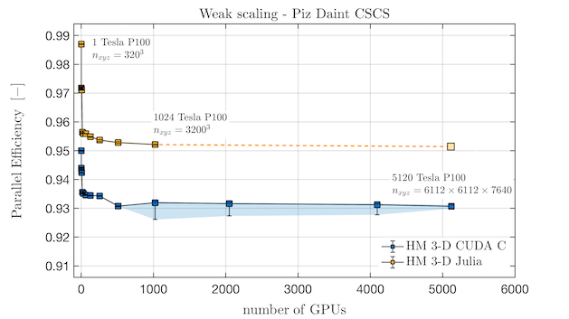

# Overview

ParallelStencil empowers domain scientists to write architecture-agnostic high-level code for parallel high-performance stencil computations on GPUs and CPUs. Performance similar to CUDA C / HIP can be achieved, which is typically a large improvement over the performance reached when using only [CUDA.jl](https://github.com/JuliaGPU/CUDA.jl) or [AMDGPU.jl](https://github.com/JuliaGPU/AMDGPU.jl) [GPU Array programming](https://cuda.juliagpu.org/stable/usage/array/). For example, a 2-D shallow ice solver presented at JuliaCon 2020 [Omlin2020JuliaCon](@cite) achieved a nearly 20 times better performance than a corresponding [GPU Array programming](https://cuda.juliagpu.org/stable/usage/array/) implementation; in absolute terms, it reached 70% of the theoretical upper performance bound of the used Nvidia P100 GPU, as defined by the effective throughput metric, `T_eff` (note that `T_eff` is very different from common throughput metrics, see [Performance metric](@ref performance-metric)). The GPU performance of the solver is reported in green, the CPU performance in blue:

```@raw html

```

ParallelStencil relies on the native kernel programming capabilities of [CUDA.jl](https://github.com/JuliaGPU/CUDA.jl), [AMDGPU.jl](https://github.com/JuliaGPU/AMDGPU.jl), [Metal.jl](https://github.com/JuliaGPU/Metal.jl), the multi-architecture [KernelAbstractions.jl](https://github.com/JuliaGPU/KernelAbstractions.jl) package (enabling [runtime hardware selection](@ref interactive-prototyping-runtime-hardware-selection)), and on [Polyester.jl](https://github.com/JuliaSIMD/Polyester.jl) and [Base.Threads](https://docs.julialang.org/en/v1/base/multi-threading/) for high-performance computations on GPUs and CPUs, respectively. It is seamlessly interoperable with [ImplicitGlobalGrid.jl](https://github.com/eth-cscs/ImplicitGlobalGrid.jl), which renders the distributed parallelization of stencil-based GPU and CPU applications on a regular staggered grid almost trivial and enables close to ideal weak scaling of real-world applications on thousands of GPUs [Omlin2020JuliaCon, Raess2020JuliaCon, Raess2019JuliaCon, Raess2019PASC](@cite). Moreover, ParallelStencil enables hiding communication behind computation with a simple macro call and without any particular restrictions on the package used for communication. ParallelStencil has been designed in conjunction with [ImplicitGlobalGrid.jl](https://github.com/eth-cscs/ImplicitGlobalGrid.jl) for simplest possible usage by domain-scientists, rendering fast and interactive development of massively scalable high performance multi-GPU applications readily accessible to them. Furthermore, we have developed a self-contained approach for "Solving Nonlinear Multi-Physics on GPU Supercomputers with Julia" relying on ParallelStencil and [ImplicitGlobalGrid.jl](https://github.com/eth-cscs/ImplicitGlobalGrid.jl) [Omlin2020JuliaCon](@cite). ParallelStencil's feature to hide communication behind computation was showcased when a close to ideal weak scaling was demonstrated for a 3-D poro-hydro-mechanical real-world application on up to 1024 GPUs on the Piz Daint Supercomputer [Omlin2020JuliaCon](@cite):

```@raw html

```

A particularity of ParallelStencil is that it enables writing a single high-level Julia code that can be deployed both on a CPU or a GPU. In conjunction with [ImplicitGlobalGrid.jl](https://github.com/eth-cscs/ImplicitGlobalGrid.jl) the same Julia code can even run on a single CPU thread or on thousands of GPUs/CPUs (see the [50-lines multi-xPU example](@ref example-multixpu)).

Beyond traditional high-performance computing, ParallelStencil supports [automatic differentiation of architecture-agnostic parallel kernels](@ref usage-ad) relying on [Enzyme.jl](https://github.com/EnzymeAD/Enzyme.jl), enabling both high-level and generic syntax for maximal flexibility.
