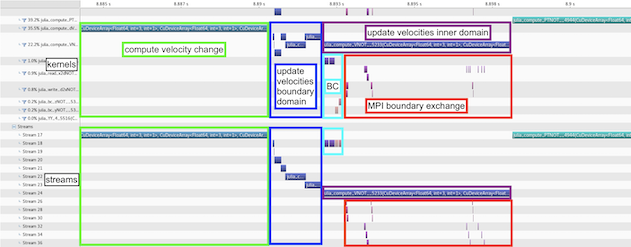

# Usage

## [Parallelization and optimization with one macro call](@id usage-parallel)
A simple call to [`@parallel`](@ref) is enough to parallelize and optimize a function and to launch it. The package used underneath for parallelization is defined in a call to [`@init_parallel_stencil`](@ref) beforehand. The following example outlines how to run parallel computations on a GPU using the native kernel programming capabilities of [CUDA.jl](https://github.com/JuliaGPU/CUDA.jl) underneath (omitted lines are represented with `#(...)`, omitted arguments with `...`):
```julia
#(...)
@init_parallel_stencil(CUDA,...)
#(...)
@parallel function diffusion3D_step!(...)
    #(...)
end
#(...)
@parallel diffusion3D_step!(...)
```
Automatic advanced fast memory usage optimization (of shared memory and registers) can be activated with the keyword argument `memopt=true`:
```julia
@parallel memopt=true function diffusion3D_step!(...)
    #(...)
end
#(...)
@parallel diffusion3D_step!(...)
```
Note that arrays are automatically allocated on the hardware chosen for the computations (GPU or CPU) when using the provided allocation macros: [`@zeros`](@ref), [`@ones`](@ref), [`@rand`](@ref), [`@falses`](@ref), [`@trues`](@ref), [`@fill`](@ref). The array types matching the chosen package and number type are available in the module [`Data`](@ref data-module) that [`@init_parallel_stencil`](@ref) creates in the calling module (e.g. `Data.Array`).


## [Backends](@id usage-backends)
The following packages are supported for parallelization:

:::code-group

```julia [Nvidia GPUs]
using ParallelStencil
@init_parallel_stencil(CUDA, Float64, 3)
```

```julia [AMD GPUs]
using ParallelStencil
@init_parallel_stencil(AMDGPU, Float64, 3)
```

```julia [Apple GPUs]
using ParallelStencil
@init_parallel_stencil(Metal, Float32, 3)
```

```julia [Runtime selection]
import CUDA  # Import the GPU packages to be used at runtime.
using ParallelStencil
@init_parallel_stencil(package=KernelAbstractions, numbertype=Float64, ndims=3)
```

```julia [CPUs]
using ParallelStencil
@init_parallel_stencil(Threads, Float64, 3)
```

```julia [CPUs (Polyester)]
using ParallelStencil
@init_parallel_stencil(Polyester, Float64, 3)
```

:::

The support for GPUs ([CUDA.jl](https://github.com/JuliaGPU/CUDA.jl), [AMDGPU.jl](https://github.com/JuliaGPU/AMDGPU.jl) or [Metal.jl](https://github.com/JuliaGPU/Metal.jl)), for [KernelAbstractions.jl](https://github.com/JuliaGPU/KernelAbstractions.jl) and for [Polyester.jl](https://github.com/JuliaSIMD/Polyester.jl) is provided with package extensions and requires therefore an explicit installation of the corresponding package. Note that it is not required to import the single-architecture backend package explicitly; this is automatically done by [`@init_parallel_stencil`](@ref). With [Base.Threads](https://docs.julialang.org/en/v1/base/multi-threading/) and [Polyester.jl](https://github.com/JuliaSIMD/Polyester.jl), the number of threads used is defined when starting Julia (e.g. `julia -t 8` or with the environment variable [`JULIA_NUM_THREADS`](https://docs.julialang.org/en/v1/manual/environment-variables/#JULIA_NUM_THREADS)). When using KernelAbstractions, the session starts on the CPU and the hardware target can be switched at runtime (see [Interactive prototyping with runtime hardware selection](@ref interactive-prototyping-runtime-hardware-selection)).


## [Stencil computations with math-close notation](@id usage-math-close)
ParallelStencil provides submodules for computing finite differences in 1-D, 2-D and 3-D with a math-close notation ([`FiniteDifferences1D`](@ref ParallelStencil.FiniteDifferences1D), [`FiniteDifferences2D`](@ref ParallelStencil.FiniteDifferences2D) and [`FiniteDifferences3D`](@ref ParallelStencil.FiniteDifferences3D)). Custom macros to extend the finite differences submodules or for other stencil-based numerical methods can be readily plugged in. The following example shows a complete function for computing a time step of a 3-D heat diffusion solver using `FiniteDifferences3D`:
```julia
#(...)
using ParallelStencil.FiniteDifferences3D
#(...)
@parallel function diffusion3D_step!(T2, T, Ci, lam, dt, dx, dy, dz)
    @inn(T2) = @inn(T) + dt*(lam*@inn(Ci)*(@d2_xi(T)/dx^2 + @d2_yi(T)/dy^2 + @d2_zi(T)/dz^2));
    return
end
```
The macros used in this example are described in the [API reference](@ref ParallelStencil.FiniteDifferences3D) and can also be queried from the [Julia REPL](https://docs.julialang.org/en/v1/stdlib/REPL/):
```julia-repl
julia> using ParallelStencil.FiniteDifferences3D
julia>?
help?> @inn
  @inn(A): Select the inner elements of A. Corresponds to A[2:end-1,2:end-1,2:end-1].

help?> @d2_xi
  @d2_xi(A): Compute the 2nd order differences between adjacent elements of A along the along dimension x and select the inner elements of A in the remaining dimensions. Corresponds to @inn_yz(@d2_xa(A)).
```
Note that `@d2_yi` and `@d2_zi` perform the analogue operations as `@d2_xi` along the dimension y and z, respectively.

A complete application is shown in the [50-lines example](@ref example-single-xpu).


## [Architecture-agnostic low level kernel programming](@id usage-low-level)
High-level stencil computations with math-close notation can be completed with index-based programming using the macro [`@parallel_indices`](@ref). For example, the following kernel enables setting Neumann boundary conditions in dimension y (`∂A/∂y = 0`) when using finite differences in 3-D:
```julia
@parallel_indices (ix,iz) function bc_y!(A)
    A[ix,   1, iz] = A[ix,     2, iz]
    A[ix, end, iz] = A[ix, end-1, iz]
    return
end
```
It can be launched as follows:
```julia
@parallel (1:size(A,1), 1:size(A,3)) bc_y!(A)
```
Furthermore, a set of architecture-agnostic low level kernel language constructs is supported in these [`@parallel_indices`](@ref) kernels (see [Kernel language](@ref) in the API reference). They enable, e.g., explicit usage of shared memory (see [this 2-D heat diffusion example](https://github.com/omlins/ParallelStencil.jl/blob/main/examples/diffusion2D_shmem_novis.jl)) and usage of warp-level primitives.


## [Interactive prototyping with runtime hardware selection](@id interactive-prototyping-runtime-hardware-selection)
The KernelAbstractions backend keeps the familiar parse-time [`@init_parallel_stencil`](@ref) workflow while enabling runtime hardware switches through the [`@select_hardware`](@ref) and [`@current_hardware`](@ref) macros; the runtime hardware target defaults to CPU and can be switched as many times as desired during a session without requiring redefinition of kernels or reinitialization of the backend (these macros insert calls to corresponding functions which will be executed at runtime, i.e. the hardware switch occurs at runtime, not at parse time, following the normal control flow of the user program). The following copy-pasteable example outlines this workflow with a simple SAXPY kernel, demonstrating initial execution on CPU followed by a switch to CUDA-capable GPU and a second execution there:
```julia
# --- Session setup -----------------------------------------------------
import CUDA                                                             # 1 Import backends to be used by the KernelAbstractions backend
using ParallelStencil
@init_parallel_stencil(package=KernelAbstractions, numbertype=Float32)  # 2 Initialize KernelAbstractions backend at parse time
const N = 2;
const α = 1.5;

# --- Kernel definition -------------------------------------------------
@parallel_indices (i) function saxpy!(Y, α, X)                          # 3 Define a single time a hardware-agnostic SAXPY kernel
  Y[i] = α * X[i] + Y[i]
  return
end

# --- First run on default runtime hardware (CPU) -----------------------
println("Current runtime hardware target: ", @current_hardware())       # 4 Query current (default) runtime hardware target
X = @fill(3, N)                                                         # 5 Allocate data on the current target
Y = @ones(N)                                                            # ...
@parallel saxpy!(Y, α, X)                                               # 6 Launch kernel on the current target
Y                                                                       # 7 Observe correct results

# --- Reselect runtime hardware to CUDA-capable GPU and run again -------
@select_hardware(:gpu_cuda)                                             # 8 Switch runtime hardware target to CUDA-capable GPU
println("Current runtime hardware target: ", @current_hardware())       # 9 Confirm the CUDA-capable GPU runtime hardware target
X = @fill(3, N)                                                         # 10 Allocate data on the new target
Y = @ones(N)                                                            # ...
@parallel saxpy!(Y, α, X)                                               # 11 Launch kernel on the new target without redefining anything
Y                                                                       # 12 Observe correct results
```
The supported runtime hardware targets and the symbols to select them are listed in the documentation of [`select_hardware`](@ref).

!!! note "Trade-offs of the KernelAbstractions backend"
    The convenience modules `Data` and `TData` with fixed data types are only available for single-architecture backends. Warp-level primitives are only partially supported in [`@parallel_indices`](@ref) kernels. [`@hide_communication`](@ref) has no effect with KernelAbstractions (but the code nevertheless executes correctly).


## [Seamless interoperability with communication packages and hiding communication](@id usage-communication)
ParallelStencil is seamlessly interoperable with [ImplicitGlobalGrid.jl](https://github.com/eth-cscs/ImplicitGlobalGrid.jl), as shown in the [50-lines multi-xPU example](@ref example-multixpu). The same is a priori true for any communication package that allows to explicitly decide when the required communication occurs; an example is [MPI.jl](https://github.com/JuliaParallel/MPI.jl) (besides, [MPI.jl](https://github.com/JuliaParallel/MPI.jl) is also seamlessly interoperable with [ImplicitGlobalGrid.jl](https://github.com/eth-cscs/ImplicitGlobalGrid.jl) and can extend its functionality).

Moreover, ParallelStencil enables hiding communication behind computation with a simple call to [`@hide_communication`](@ref). In the following example, the communication performed by `update_halo!` (from the package [ImplicitGlobalGrid.jl](https://github.com/eth-cscs/ImplicitGlobalGrid.jl)) is hidden behind the computations done by `@parallel diffusion3D_step!`:
```julia
@hide_communication (16, 2, 2) begin
    @parallel diffusion3D_step!(T2, T, Ci, lam, dt, dx, dy, dz);
    update_halo!(T2);
end
```
This enables close to ideal weak scaling of real-world applications on thousands of GPUs/CPUs [Omlin2020JuliaCon, Raess2020JuliaCon](@cite). Profiling a 3-D viscous Stokes flow application using the Nvidia visual profiler (nvvp) graphically exemplifies how the update velocities kernel is split up in boundary and inner domain computations and how the latter overlap with point-to-point MPI communication for halo exchange:

```@raw html

```

Independent kernels can furthermore be overlapped with each other with [`@overlap`](@ref).


## [Logical arrays of small arrays / structs](@id usage-cellarrays)
Logical arrays of small arrays / structs enabling optimized data access can be conveniently created with the architecture-agnostic allocation macros introduced above. To this purpose, ParallelStencil leverages `CellArray`s (from [CellArrays.jl](https://github.com/omlins/CellArrays.jl), which relies in turn on [StaticArrays.jl](https://github.com/JuliaArrays/StaticArrays.jl)). To create a logical array of small arrays, it is sufficient to pass to any of these allocation macros the keyword `celldims` with the dimensions of the inner arrays, e.g.:
```julia
nx, ny, nz = 128, 128, 128
celldims   = (4, 4)
A = @rand(nx, ny, nz, celldims=celldims)
```
To create a logical array of structs, a custom cell type can be defined using the macro [`@CellType`](@ref) and then passed to any of the allocation macros via the keyword `celltype`, e.g.:
```julia
@CellType SymmetricTensor3D fieldnames=(xx, yy, zz, yz, xz, xy)
#(...)
A = @zeros(nx, ny, nz, celltype=SymmetricTensor3D)
```
Details are found in the documentation of the [allocation macros](@ref Allocation).

Fields on a staggered grid (scalar, vector and tensor fields) can be allocated in one go with the macros of the submodule [`FieldAllocators`](@ref ParallelStencil.FieldAllocators).


## [Automatic differentiation of architecture-agnostic parallel kernels](@id usage-ad)
[Enzyme.jl](https://github.com/EnzymeAD/Enzyme.jl)-powered automatic differentiation of architecture-agnostic parallel kernels is fully integrated into ParallelStencil's API and exposed both with high-level and generic syntax. The keyword argument `∇` is enough to trigger a parallel call to the gradient kernel instead of the kernel itself, e.g:
```julia
#(...)
@parallel_indices (ix) function f!(A, B, a)
    A[ix] += a * B[ix] * 100.65
    return
end

N = 16
a = 6.5
A = @rand(N)
B = @rand(N)
Ā = @ones(N)
B̄ = @ones(N)

@parallel f!(A, B, a)                 # normal call of f!
@parallel ∇=(A->Ā, B->B̄) f!(A, B, a)  # call to the gradient of f!, differentiated with respect to A and B
```
Keyword arguments to [`@parallel`](@ref) allow to customize the automatic differentiation. Automatic differentiation is supported for both [`@parallel`](@ref) and [`@parallel_indices`](@ref) kernels.

The generic syntax, which is enabled by the submodule [`ParallelStencil.AD`](@ref), provides maximal flexibility. For the above example it looks as follows:
```julia
import ParallelStencil.AD
using Enzyme
#(...)
@parallel f!(A, B, a)                                                                                                                 # normal call of f!
@parallel configcall=f!(A, B, a) AD.autodiff_deferred!(Enzyme.Reverse, f!, DuplicatedNoNeed(A, Ā), DuplicatedNoNeed(B, B̄), a)  # call to the gradient of f!, differentiated with respect to A and B
```
The submodule [`ParallelStencil.AD`](@ref) contains GPU-compatible wrappers of Enzyme functions (returning always `nothing` as required by the backend packages [CUDA.jl](https://github.com/JuliaGPU/CUDA.jl) and [AMDGPU.jl](https://github.com/JuliaGPU/AMDGPU.jl)); the wrapper `AD.autodiff_deferred!` maps, e.g., `Enzyme.autodiff_deferred`. The keyword argument `configcall` makes it trivial to call these generic functions for automatic differentiation with the right launch parameters.


## Module documentation callable from the Julia REPL / IJulia
The module documentation can be called from the [Julia REPL](https://docs.julialang.org/en/v1/stdlib/REPL/) or in [IJulia](https://github.com/JuliaLang/IJulia.jl):
```julia-repl
julia> using ParallelStencil
julia>?
help?> ParallelStencil
```
To see a description of a macro or module type `?<macroname>` (including the `@`) or `?<modulename>`, respectively. The same documentation is found in the [API reference](api.md).
